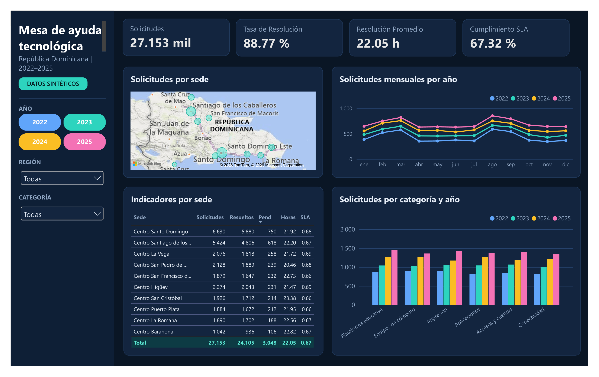

# Technology Help Desk Dashboard | Power BI

Final project: interactive Power BI dashboard analyzing technology help-desk tickets from 2022 to 2025.

## Dashboard Preview


## Overview
The dashboard tracks ticket volume, performance, and trends over time, with filters by year, site, category, priority, and channel.

## Data Model
- **Fact table:** FactTickets
- **Dimension tables:** DimSedes, DimCategorias, DimPrioridades, DimCanales
- **Calendar table** for time-based analysis
- Each dimension connects to FactTickets through a one-to-many relationship.

## Key Measures (DAX)

**Total Tickets**: total number of tickets in the current filter context.
```dax
Total Tickets = COUNTROWS ( FactTickets )
```

**Tickets Resueltos**: tickets with status "Resuelto".
```dax
Tickets Resueltos =
CALCULATE (
    [Total Tickets],
    KEEPFILTERS ( FactTickets[Estado] = "Resuelto" )
)
```

**Tickets Pendientes**: tickets that are still "Abierto" or "En proceso".
```dax
Tickets Pendientes =
CALCULATE (
    [Total Tickets],
    KEEPFILTERS ( FactTickets[Estado] IN { "Abierto", "En proceso" } )
)
```

**Horas Promedio Resolucion**: average resolution time (hours) of resolved tickets with valid values.
```dax
Horas Promedio Resolucion =
AVERAGEX (
    FILTER (
        FactTickets,
        FactTickets[Estado] = "Resuelto"
            && NOT ISBLANK ( FactTickets[HorasResolucion] )
            && FactTickets[HorasResolucion] >= 0
    ),
    FactTickets[HorasResolucion]
)
```

**Cumplimiento SLA**: share of resolved tickets closed within the SLA hours defined for their priority.
```dax
Cumplimiento SLA =
VAR Evaluables =
    FILTER (
        FactTickets,
        FactTickets[Estado] = "Resuelto"
            && NOT ISBLANK ( FactTickets[HorasResolucion] )
            && FactTickets[HorasResolucion] >= 0
            && NOT ISBLANK ( RELATED ( DimPrioridades[SLAHoras] ) )
            && RELATED ( DimPrioridades[SLAHoras] ) > 0
    )
VAR DentroSLA =
    FILTER (
        Evaluables,
        FactTickets[HorasResolucion] <= RELATED ( DimPrioridades[SLAHoras] )
    )
RETURN
    DIVIDE ( COUNTROWS ( DentroSLA ), COUNTROWS ( Evaluables ) )
```

## Process
1. Cleaned and typed the data in Power Query.
2. Built the data model and relationships.
3. Created the Calendar table and DAX measures.
4. Designed the dashboard.

## Full Report
[Read the full report (PDF)](HelpDeskReport.pdf) (in Spanish)

## Tools
Power BI Desktop, Power Query, DAX, CSV

## Files
- `HelpDesk.pbix.pbix`: Power BI report
- `data/`: source CSV files
- `HelpDeskReport.pdf`: project report (PDF)
- `Dashboard.png`: dashboard screenshot
